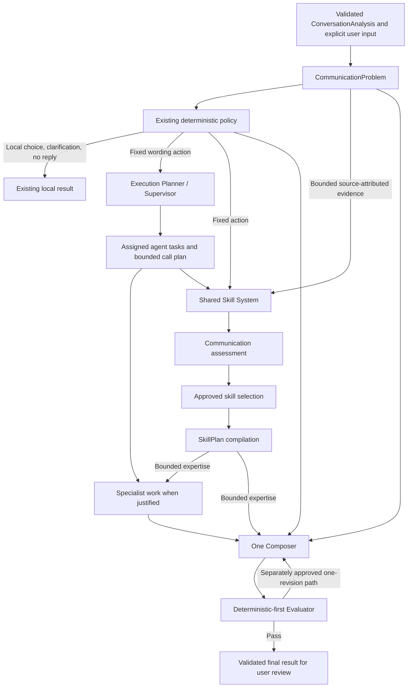

# Agent architecture implementation plan

Status: revised architecture; B1/B2 frozen; B3 shadow-only complete pending review; B4/B5 hold

Updated: 2026-10-04
Branch: `codex/agent-architecture`

This is the durable, overall plan for growing the existing coaching pipeline into a bounded plan-and-execute architecture. It is not an active milestone execution plan. Before implementation, add the chosen increment to `docs/roadmap.md` and create the corresponding `.agent/plans/<milestone-id>.md` under `.agent/PLANS.md`. The current roadmap explicitly excludes a multi-agent runtime from Phase 4 and leaves later milestones unapproved.

## 1. Purpose and goals

The system should understand a communication problem once, preserve the user's meaning and decision, use shared communication expertise where useful, and produce one coherent message. A Supervisor/Execution Planner may assign reasoning tasks to specialist agents, but those agents do not own exclusive skill sets. The Skill System is a shared expertise service that may assess communication needs, select approved skills, and compile guidance for more than one agent task. Normal requests should retain roughly the current one-call wording path after screenshot extraction. More model calls are an exception justified by demonstrated quality improvement on complex cases.

Success means: the existing `AgentAction` behavior remains authoritative; the Agent System alone controls action, agent topology, execution depth, call budget, revision and stopping; the Skill System supplies bounded evidence-backed communication expertise without altering those decisions. Simple requests do not activate irrelevant specialists, selected skills come from the approved catalog, the Composer preserves hard constraints and the user's requested change, and neither extra calls nor new data paths weaken privacy. The user still reviews and explicitly copies a result. The coach never sends it.

> The Agent System owns the fixed action, orchestration, execution plan, agent selection, model-call budget, revision decisions, and stop conditions. The Skill System receives the fixed action plus bounded source-attributed validated evidence and returns communication expertise. It may assess communication needs, select approved skills, and compile guidance, but cannot change the action, invent user intent, or control the agent loop.

### Decision status

| Status             | Decision                                                                                                                                                                                                                                                                                                                                                                                                                                                                  |
| ------------------ | ------------------------------------------------------------------------------------------------------------------------------------------------------------------------------------------------------------------------------------------------------------------------------------------------------------------------------------------------------------------------------------------------------------------------------------------------------------------------- |
| Settled now        | Keep deterministic policy, the canonical approved skill registry, provider-neutral AI core, trusted desktop-to-provider topology, deterministic-first checks, one Composer, and shadow-first migration. Agent owns action/loop/agent topology; Skill owns communication assessment, selection and SkillPlan compilation within fixed task bounds. Skills are reusable across agent tasks, not exclusively owned by domains. |
| Provisional for V1 | B2 defines a first bounded structural evidence projection, six communication signals and a conservative deterministic rank adjustment, all pending review. Optional non-exclusive metadata, later selection thresholds and numeric execution budgets remain provisional. |
| Integration hold   | B2 is frozen at `60e2e9c`; B3 uses committed Skills checkpoint `dcc52eb`, whose approved runtime values match this branch. Newer skill revisions require a fresh compatibility check; production cutover remains a separate gate. A complete one-owner-per-skill table is no longer a gate. |
| Deferred           | Model-assisted skill assessment/SkillPlan compilation, semantic retrieval, independent specialist model calls, model evaluator and per-task model selection require separate evidence and approved scope. |

## 2. Current-system baseline

`packages/contracts/src/conversation-analysis.ts` defines strict, observation-only `ConversationAnalysis`: visible messages and speaker/order confidence, a separate draft, contact signals, language, warnings, and overall confidence. It deliberately excludes relationship claims, intent, action, and rewriting. The Phase 2 vision adapter extracts this once; Phase 3 reuses the validated result.

`packages/contracts/src/coaching.ts` defines `CoachingRequest` as analysis plus an optional action or clarification selection. It has no separate free-form rewrite instruction or confirmed recipient/relationship input. `packages/ai/src/coaching-policy.ts` deterministically fixes one of six actions: rewrite, complete, suggest reply, offer choices, ask one material clarification, or no reply. The user-selection continuation retains the selected intent.

`packages/ai/src/coaching-engine.ts` is the current orchestration point. It validates input and model capabilities, gets the policy decision, handles local actions without a wording call, derives a `SkillContext`, calls a narrow `CommunicationSkillPlanner`, and passes compact guidance to a provider-neutral `CoachingTextGenerator`. Invalid provider results receive safe errors. Its deterministic guards check fixed policy metadata, high-signal refusal/commitment/uncertainty reversals, and bounded factual anchors; they do not prove complete semantic preservation.

`packages/skills/src/registry.ts` contains 21 manually approved `ACTIVE` skills: 14 universal, three English, and four Chinese. `packages/contracts/src/skills.ts` owns their strict definitions and the bounded skill context/plan schemas. `packages/skills/src/engine.ts` validates the registry, filters by action/language/situation/intent, ranks candidates, resolves declared conflicts, and composes at most four skills into principles and avoidances. This is one flat atomic-skill selector, not a broad capability or specialist router. The registry's `useWhen`/`doNotUseWhen` text is defined and validated but is not independently interpreted as a runtime routing rule.

`packages/ai/src/openai-coaching-adapter.ts` adapts the provider-neutral generator to one OpenAI structured wording call, sending bounded visible context and guidance. The provider returns wording only; policy-owned action and confidence are reattached locally. `packages/ai/src/coaching-prompt.ts` carries the current generation instructions. `apps/desktop/src/main/coaching.ts` supplies single-flight service behavior; trusted Electron main holds the adapter/credential and the renderer gets validated results and explicit Copy. `apps/api` is not the default proxy. Existing contract, policy, skill, integration, adapter, and desktop tests provide regression anchors; `packages/test-fixtures` supplies synthetic cases.

Preserve the baseline invariant from `docs/product-behavior.md`: infer first, generate when confident, offer choices when uncertain, and ask only when necessary. The extra architecture must not allow a model supervisor or specialist to override the fixed policy action.

## 3. Target architecture



Message understanding initially uses deterministic normalization of validated analysis plus explicit user input. `CommunicationProblem` is a request-scoped, evidence-qualified representation of source/draft, context, goal, language, meaning to preserve, constraints and uncertainty. The existing policy alone fixes whether and what to generate. The Supervisor chooses which reasoning/execution roles run, their tasks, execution depth, call budget and stop conditions. The shared Skill System assesses communication needs from the fixed action and bounded validated evidence, selects approved skills, and compiles a `SkillPlan`; it does not choose agents or workflow. Skill access may occur before or during specialist work, subject to the same authority boundary. A simple path may use SkillPlan guidance directly in the Composer without a specialist agent.

Before cutover, the existing flat selector alone supplies production guidance to the Composer. The new path projects bounded evidence from `CommunicationProblem`, runs deterministic Skill assessment, selection and SkillPlan compilation for comparison/debug only, and makes no duplicate provider call. Review parity and meaningful differences against existing fixtures and the evolving approved catalog before authorizing production use.

```text
Existing flat selector ──────────────────────────────────→ production Composer
Fixed action + bounded evidence → shared Skill pipeline ─→ comparison only
```

The first target is a primary coherent message in the existing result shape. Existing alternatives can remain when policy and UI call for them, but specialists never each produce a competing final set. Any later decision to change the renderer-visible result contract belongs to a separate milestone.

## 4. Responsibility boundaries

| Layer | Input → output | Authority and forbidden decisions | V1 execution |
| --- | --- | --- | --- |
| Message understanding | Validated observations and explicit user input → `CommunicationProblem` | Agent normalizes source, goal, constraints, provenance and unknowns; no identity/relationship promotion from a name or avatar. | Deterministic. |
| Existing coaching policy | Validated request/problem → fixed `AgentAction` | Sole action authority. Neither Supervisor, Skill System nor specialist changes it. | Deterministic. |
| Execution Planner / Supervisor | Fixed action and problem → bounded task plan | Agent chooses roles, task assignments, depth, call budget, sequencing, revisions and stop conditions; does not own skill semantics. | Deterministic first. |
| Specialist agents | Assigned task, fixed action, permitted evidence and optional shared `SkillPlan` → findings | Reason within assigned scope; may reuse shared skills, but cannot claim exclusive ownership or change action. | Optional; deterministic guidance first. |
| Skill assessment | Fixed action and bounded source-attributed evidence → communication needs/uncertainty | Skill System assesses communication expertise needed, not which agents run or what the user intended beyond evidence. | Deterministic default; model port dormant. |
| Skill selection | Assessment and approved catalog → canonical skill references with evidence-backed reasons | Skill System applies status, action, language, eligibility and conflicts; no exclusive domain gate. | Existing selector adapted behind validated seam. |
| SkillPlan compiler | Selected references, action, permitted evidence and constraints → bounded guidance | Skill System compiles principles, avoidances, tradeoffs and recommendations; no workflow commands or final reply. | Deterministic default; separately testable. |
| Composer | Problem, fixed policy, `SkillPlan` and bounded findings → wording | Agent owns one coherent final voice; cannot re-decide action or accept unsupported skill claims as facts. | Existing provider-neutral generator evolves. |
| Evaluator | Candidate, source problem, policy and plan → `EvaluationResult` | Agent enforces schema, fixed action and constraints; no autonomous retry. | Deterministic first. |
| Final output | Validated result → review/copy UI | Agent returns reviewable result; never send or silently insert. | Existing desktop path. |

## 5. Skill-system integration contract

The [Agent–Skill System integration plan](agent-skill-integration-plan.md) specifies the fixed-action, evidence, result, failure, snapshot and loop-authority boundary for this seam. B1 implements only shared contracts and validators against a supplied canonical approved registry; it does not import or freeze the uncommitted skill catalog.

`packages/skills` is the sole runtime owner of approved skill definitions, IDs, versions, status, eligibility, compatibility/conflicts, communication assessment, skill selection and `SkillPlan` compilation. `packages/contracts` owns bounded Zod-first values needed by both packages. `packages/ai` owns `CommunicationProblem`, fixed policy action, agent tasks, execution budgets and workflow, and must not copy the catalog or delegate loop decisions to skills. The Skill System is shared by all authorized agent roles; no skill is exclusive property of a specialist agent.

The Agent passes the fixed `AgentAction`, descriptive task scope and bounded validated `SkillEvidence` with source/provenance references. `taskPurpose` cannot add a user goal, override action or direct orchestration; any goal-bearing purpose must be grounded in validated user input. Use the existing Phase A `CommunicationProblem` provenance conventions where possible: distinguish explicit user statement or instruction, validated conversation observation, deterministic derivation, policy-owned fact and unresolved/unknown evidence without prematurely fixing exact enum names. Each item has a bounded ID, kind, source, structured value or minimal excerpt, and confidence where appropriate. The Skill System may cite evidence IDs in assessment and selection reasons; it cannot fabricate evidence, convert uncertainty into fact, infer identity/relationship from contact cues, invent user intent or reinterpret the fixed action. Insufficient evidence yields uncertainty, `NONE` or bounded failure rather than a guessed premise. Do not pass an entire screenshot, unbounded transcript, memory, identity profile or hidden reasoning through the seam.

Keep three independently testable Skill-internal seams. **Assessment** identifies evidence-backed communication needs/signals and uncertainty without selecting skills. **Selection** consumes that assessment, fixed action and approved catalog, then returns canonical skill ID/version references, evidence-backed reasons and an explicit selected/none/failed/uncertain state without composed advice. **SkillPlan compilation** consumes those exact selected references, fixed action, allowed evidence and constraints, then returns bounded principles, avoidances, tradeoffs and recommendations with evidence references. `CommunicationAssessment`, `SkillSelectionResult` and `SkillPlan` contain no `action` echo or orchestration fields; strict schemas reject `action`, `nextAction`, `agent`, `nextAgent`, `shouldContinue`, `shouldStop`, `shouldRevise`, `callModel`, `executionDepth`, `callBudget` and equivalents. A `SkillPlan` cannot cite an unselected skill or command Composer/Evaluator/agents. The current combined `CommunicationPlan` and `CommunicationSkillPlanner` are compatibility seams; split their assessment/selection/compilation responsibilities internally without creating a second catalog or changing the current production result until shadow review.

Assessment, selection and compilation remain deterministic in initial Phase B. A provider-neutral `SkillAssessmentPort` returns only `CommunicationAssessment`; later model-assisted assessment or SkillPlan compilation may use appropriate provider-neutral ports. The Skill System must not import a provider SDK, Electron or `packages/ai`. Any future model call requires a separate approved quality/privacy gate and an Agent-granted call allowance within the Agent-owned budget; model output is schema-validated against the same action/evidence/catalog and cannot issue agent-loop commands. No additional model call is required for Phase B.

Orchestration may assume one validated approved catalog snapshot with unambiguous IDs and exact versions; it must not assume exactly 21 skills, today's file layout, name prefixes, authoring families, one skill per capability/domain, or that every new skill needs Supervisor code changes. Runtime never consumes draft/generated skills. A later newly active, removed, renamed or unresolved ID fails reference validation until reviewed; Phase B invents no alias/migration system. Selection and SkillPlan compilation remain request-scoped in memory; private text and skill choices are not saved as conversation history.

## 6. Communication assessment and metadata

Communication capabilities such as clarity, coordination, empathy, relationship preservation, conflict management, assertiveness and tone/style describe **communication needs**, not agent roles. The Skill System may assess them from fixed action and bounded source-attributed evidence, with evidence IDs, uncertainty/abstention and deterministic ranks where useful. They are not calibrated probabilities, user-goal replacements or commands to run specialist agents. The Agent may classify task complexity and assign a conflict-focused agent, but that agent-task choice is distinct from Skill-owned communication assessment.

A skill may support zero, one or several communication-domain labels and zero, one or several capability labels. Such labels are optional **non-exclusive communication metadata**, not hard eligibility gates or agent ownership. A companion `SkillId → CommunicationMetadata` mapping may be useful if validated against the approved snapshot; do not require each active skill to have exactly one domain or automatically derive labels from the skill authoring taxonomy, path or ID prefix. Introduce metadata only where it improves measured selection or evaluation. Preserve the canonical registry as the sole skill source.

## 7. Multi-agent specialists and shared skills

The Supervisor owns agent topology and assigns bounded tasks to reasoning/execution roles. Specialist agents may receive an Agent-approved `SkillPlan` or request one through an orchestrator-approved Skill boundary. They do not keep private copies of skill definitions or own exclusive subsets. For example, a conflict-focused task and a relationship-focused task may both use `emotional_validation` if the approved Skill System selects it from their permitted evidence. That reuse does not authorize either agent to change the fixed action, add user intent, spawn another agent or decide whether Composer/Evaluator runs.

Former `repair_and_tension`, `care_and_rapport`, `clarity_and_coordination` and `expression_and_style` IDs are **not frozen B1 integration contracts or mandatory owner IDs** under this revision. They may be reviewed later as optional communication metadata labels; do not implement `SpecialistDomainId` as a hard Agent-selected scope. The skill-side families `accountability_repair`, `recognition_support`, `understanding_inquiry`, `requests_options`, `decisions_limits`, `conflict_feedback`, `coordination`, `explanation_connection` and `language_expression` remain authoring/taxonomy concepts, not automatic runtime capability labels. A specialist role name, authoring family and communication metadata label are three distinct concepts.

## 8. Execution planning and budgets

Agent-owned depth classification starts from explicit instruction and observed complexity: one local tone/style operation versus multiple goals, supported conflict or high sensitivity, competing priorities, ambiguous intent, speaker uncertainty, factual/commitment constraints, and whether additional agent reasoning would materially change the result. Communication-need assessment inside the Skill System does not itself escalate depth or spend a model-call budget. Relationship uncertainty alone is not a reason to ask the user or run deeper agents. The policy's local choice/clarification/no-reply branches continue to bypass wording work.

These are proposed upper bounds for coaching **after** any separately triggered screenshot-understanding call; validate them before enabling deeper paths:

| Path | Trigger | Agent tasks / Skill System | Model calls and revisions |
| --- | --- | --- | --- |
| Simple | One clear requested change, low conflict and clear intent | No extra specialist needed; zero to four approved shared skills. | One composer call; deterministic Skill assessment/compilation; no revision. |
| Standard | Several compatible needs, clear action and facts | Agent may assign bounded deterministic specialist work; SkillPlan is shared, not domain-owned. | One composer call; no extra model specialist call or revision initially. |
| Complex V1 | Material tradeoffs or sensitive conflict, with fixed action | Agent may assign distinct specialist tasks; each may consume allowed shared expertise. | Still one composer call by default; deterministic Skill assessment and findings. |
| Experimental deep path | Later quality evidence supports added calls | Agent selects tasks and grants explicit call allowance; Skill System cannot spend calls autonomously. | At most two specialist calls, one composer call and one composer revision: at most four wording-stage calls. No loop. |

The Agent plan records assigned tasks, ordering, hard constraints, stylistic priorities, calls allowed/used and revision allowance. Fixed policy action and explicit user instructions take precedence over stylistic preferences. A failed or invalid optional specialist finding or SkillPlan is excluded with a safe status; it cannot silently turn into a factual premise. Inability to preserve a hard constraint produces a safe failure/clarification under existing policy rules, not unchecked output.

## 9. Composer architecture

Evolve `CoachingTextGenerator` and its prompt/adapter into a composer task with a provider-neutral `ComposerInput`: normalized problem, exact policy decision, meaning anchors and hard constraints, ranked stylistic priorities, compact validated `SkillPlan` guidance, and bounded specialist findings. The OpenAI adapter still handles transport, structured output, timeouts, and provider errors; core composition does not depend on OpenAI or Electron.

The provider should receive the minimum relevant text and findings, not the full skill registry, routing trace, stable identity data, or hidden reasoning. Provider output remains wording-only with the policy metadata reattached locally. Preserve the current alternatives contract until an approved UI/product change; the primary message must be a unified rewrite, not a specialist winner. Candidate wording fragments are suggestions, and the composer must reconcile conflicting advice against hard constraints and supervisor priorities.

## 10. Evaluator architecture

The first evaluator wraps, rather than weakens, the current strict response-schema validation, policy-metadata equality, and high-signal lexical guards. Add deterministic checks where the source supports them: required/forbidden phrases or facts explicitly supplied by the user, preserved uncertainty and refusal, bounded length constraints, output language/script eligibility, contradictions in structured commitments, and whether required specialist recommendations were represented. Treat semantic equivalence, naturalness, and relationship appropriateness as evaluation questions, not claims proved by regex.

`EvaluationResult` should distinguish pass, safe failure, and actionable revision findings with concise codes rather than raw private text in logs. Initially a failure follows existing safe error behavior. A later approved complex path may pass one revision instruction to the composer, then evaluate once more; there is no recursive retry. Model-assisted evaluation is optional and cannot waive deterministic failures. Human-reviewed paired quality evaluation remains necessary before claiming the deeper architecture improves messages.

## 11. Data and contracts plan

Names below express the intended seam; fields and placement are finalized at the first implementation milestone with Zod-first schemas where required.

| Contract | Placement and purpose |
| --- | --- |
| `CommunicationProblem` | Existing internal `packages/ai` schema; promote only real cross-process fields when an actual caller requires them. Preserve source, goal, constraints, language and unknowns. |
| `SkillEvidenceSource`, `SkillEvidence` | Bounded Zod-first shared seam in `packages/contracts` when consumed by both packages; source-attributed, referenceable IDs, kind, minimal value, confidence where justified and explicit unknowns. Reuse Phase A provenance vocabulary where possible. |
| `SkillAssessmentRequest`, `CommunicationAssessment` | Shared fixed-action/evidence/descriptive-task input and bounded evidence-backed communication needs/uncertainty output; assessment does not select skills or echo action. |
| `SkillSelectionRequest`, `SkillSelectionResult`, `SkillReference` | Shared fixed-action/evidence/assessment input and bounded approved ID/version selection result, with evidence refs, uncertainty, `NONE` and `FAILED`; output has no action or loop fields. Extend current `SkillContext`/`SelectedSkill` concepts rather than duplicate them. |
| `SkillPlan` | Bounded guidance compiled from selected references plus allowed evidence/constraints, with principles, avoidances, tradeoffs, recommendations and evidence refs; cannot cite unselected skills or issue agent commands. The current `CommunicationPlan` needs a compatibility adapter during migration. |
| `SkillAssessmentPort` | Provider-neutral Skill-facing assessment abstraction in `packages/skills`: returns `CommunicationAssessment`, not selected skills; deterministic default. Future model-assisted stages need an approved Agent-granted call allowance and strict validation. No provider SDK or Electron import. |
| Communication metadata | Optional validated non-exclusive `SkillId → CommunicationMetadata` or reviewed canonical fields for communication capabilities/domains. No exactly-one owner rule and no automatic authoring-family conversion. Exact shape is deferred until B4 evidence. |
| `ExecutionPlan` | Internal validated `packages/ai` value for fixed action, assigned agent tasks, path, priorities, hard budgets and stop conditions; never a Skill output. |
| `ExecutionTrace` | Internal/test/debug bounded structural record in `packages/ai`: execution path, assigned role IDs, selection refs, budgets/usage and evaluator codes; no raw conversation, drafts, private model reasoning or provider payloads. Not persisted history/default analytics. |
| `SpecialistFinding` | Internal strict `packages/ai` finding from an Agent-assigned role, optionally referencing a shared SkillPlan; no final action or control command. |
| `ComposerInput`, `EvaluationResult` | Provider-neutral Agent-side composition and deterministic-first evaluation; existing coaching result remains the public output until separately changed. |

Avoid parallel intent, skill, action, or output schemas. Extend the existing `ConversationAnalysis`, `CoachingRequest`, `SkillContext`, `CommunicationPlan`, and coaching result contracts only where a real producer and consumer require the extension. Define hard constraints separately from soft stylistic priorities; do not collapse different confidence dimensions into one score. Bound all private text and collection sizes at entry points and before provider calls.

## 12. Package/module ownership and privacy

Dependency direction remains `apps/desktop → packages/ai → packages/skills → packages/contracts`, with `packages/ai → packages/contracts` and desktop importing contracts. `packages/skills` must not import `packages/ai`; `packages/ai` must not import Electron/Fastify. Shared evidence and selection contracts used by both belong in `packages/contracts`, preventing a cycle. No new package or service is required for V1.

`packages/contracts` owns strict shared schemas and inferred types. `packages/skills` owns approved definitions, catalog validation, communication assessment, eligibility/selection, optional non-exclusive communication metadata and SkillPlan compilation. A Skill-facing model port may be declared there, but provider-specific adapters and call authorization remain outside its core. `packages/ai` owns communication-problem normalization, fixed policy, deterministic Supervisor, role/task assignment, budgets, findings, Composer, Evaluator, provider-neutral Agent task interfaces and isolated provider adapters. Trusted Electron main constructs the pipeline, enforces single flight and credential custody, and exposes narrow validated IPC. The renderer collects any explicit rewrite instruction and presents review/copy, without receiving a stored key, registry or internal findings. `apps/api` gains no role without a documented need and privacy review.

`ExecutionTrace` is an internal, non-persistent observation seam for deterministic tests, selection/SkillPlan comparison, development debugging and later quality evaluation. It records only bounded structural role/skill IDs, selection status, call budget/usage and evaluator codes. It excludes raw conversation text, screenshots, drafts, chain-of-thought, private model reasoning, full specialist findings and provider payloads. Do not expose it as default analytics or user history. Shadow differences should be inspectable without changing production Composer input.

Screenshots and message text remain ephemeral by default. No screenshot, raw conversation, draft, generated wording, specialist finding, credential, stable identity feature, or model payload enters logs/analytics or new persistence. Extra model calls would transmit minimized conversation content directly from trusted desktop to the selected provider; before enabling them, the milestone must document capability checks, request bounds, call budget, cancellation/timeout, retention and billing disclosure, normalized failures, and why the additional disclosure improves quality. Current visible evidence outranks old memory; this plan does not enable a memory reader.

## 13. Migration plan

Each phase is a separate reviewable increment, keeps the app working, and receives a concrete `.agent/plans/` execution plan and roadmap acceptance criteria before code changes. Do not start Phase G merely because earlier interfaces exist.

Phase A — Foundation remains complete and unchanged. B1 is frozen at `0b32f9e`; B2 is frozen at `60e2e9c`. B3 uses the committed Skills baseline `dcc52eb`, whose approved runtime definitions match this branch's canonical registry values, for deterministic shadow-only compilation after B2 assessment and selection. Newer untracked Skills research is excluded. Production cutover stays on hold. A complete exactly-one-owner table is **not** a prerequisite. Each B slice needs its own reviewed scope and acceptance criteria under `.agent/PLANS.md` before implementation.

| Phase | Increment | Exit check |
| --- | --- | --- |
| A — Foundation | Existing validated `CommunicationProblem` normalization beside unchanged policy/skill flow. Complete. | Existing action/clarification/no-reply results and IPC flow unchanged. |
| B1 — Agent ↔ Skill contract | Complete: fixed action input, bounded source-attributed `SkillEvidence`, closed descriptive `taskPurpose`, supplied approved snapshot reference, distinct assessment/selection/SkillPlan seams and provider-neutral assessment port. No production behavior change. | Skill outputs omit action and loop fields; strict schemas reject unsupported evidence and unresolved references; deterministic `UNASSESSED` default. |
| B2 — Evidence-aware deterministic selection | Shadow-only bounded structural evidence, six Skill-owned signals, deterministic assessment and selection against the approved catalog fingerprint; preserve action/language/status/tag eligibility, conflicts, cap, `NONE`, `FAILED` and production output. | Selection reasons cite evidence; structural comparison explains differences; no extra model call or SkillPlan compilation. |
| B3 — SkillPlan compiler | Compile exact selected references into bounded approved guidance and compare it structurally with the existing plan; shadow-only, with no Composer change. | Selection and guidance quality can be tested separately; SkillPlan cites only selected skills and allowed evidence. |
| B4 — Communication metadata | Add validated non-exclusive capability/domain metadata only if it improves selection/evaluation; never an Agent-owned hard domain gate. | A skill may have multiple or no metadata labels; no exactly-one-owner invariant. |
| B5 — Shadow comparison and cutover review | Compare existing flat and new evidence-aware selection, guidance, `NONE`, conflicts, fixtures and human-reviewed cases while old path remains authoritative. | Separate explicit authorization is required for production cutover. |
| C — Execution planning and authorized cutover | Add deterministic path classification, assigned role tasks, priorities and budgets in `packages/ai`; switch Skill boundary only if B5 review authorizes it. | Simple requests remain cheap; limits hold on failures; policy and skill eligibility do not regress. |
| D — Specialist guidance | Build bounded findings from Agent-assigned roles, optionally consuming the same shared SkillPlan; no mandatory extra provider calls. | Only Supervisor-assigned roles run; findings cannot change action or facts. |
| E — Composer integration | Evolve provider-neutral generator around one `ComposerInput` with SkillPlan and findings. | One coherent primary result; policy metadata/privacy preserved. |
| F — Evaluator | Extract existing guards into deterministic evaluation with a dormant bounded-revision seam. | Existing invalid responses fail safely; no uncontrolled retry. |
| G — Experimental multi-agent execution | Only after reviewed quality evidence, optionally add model-assisted specialist/Skill assessment or compilation under Agent-granted budgets and privacy gates. | Measured benefit justifies calls; safe failures and human review pass. |

After each implementation increment run repository `pnpm lint`, `pnpm typecheck`, `pnpm test`, and `pnpm build`, relevant deterministic evaluation, `git diff --check`, and focused desktop/provider checks appropriate to the changed boundary. Live provider evaluation stays opt-in and separate from default tests.

## 14. Testing and evaluation strategy

Use existing synthetic policy and Phase 4 skill fixtures as the regression baseline, then add fixtures that vary explicit rewrite instruction, draft ownership, conflict, empathy, relationship uncertainty, language/script, unsupported language, hard constraints, and simultaneous goals. Tests should assert policy parity first; no specialist may convert a refusal into acceptance, infer a confirmed identity/relationship from a visible cue, invent a commitment, or change the action.

Boundary tests prove the fixed action enters Skill inputs unchanged; all Skill outputs omit action and agent-loop fields, and `taskPurpose` cannot smuggle a new goal or directive. Evidence tests preserve source/provenance and reject fabricated facts, invented intent, promoted relationship claims and unsupported certainty. Catalog tests ensure only approved active exact ID/version references resolve in the selected snapshot; eligibility, language, conflict, cap, `NONE` and `FAILED` remain intact. Assessment, selection and SkillPlan compilation are independently testable; compiled guidance cites only selected skills and allowed evidence. Optional non-exclusive metadata tests permit one skill in multiple communication domains or none, never requiring one owner. A provider-neutral model-assessment port can be swapped in tests while deterministic selection stays default and adds no Phase B model call. Agent tests prove only Supervisor chooses agent topology and only Agent chooses continue, compose, evaluate, revise or stop after Skill failure. Shadow tests compare old and new outputs while the old selector alone feeds production Composer. `ExecutionTrace` tests reject private content. Composer, Evaluator and desktop integration tests preserve hard constraints, result schema, choice/retry, explicit Copy and call budget.

Run a small reviewed live comparison before Phase G: baseline generic, deterministic shared SkillPlan guidance, and optional deeper path on the same synthetic or specifically approved redacted cases. Review meaning, instruction fit, naturalness, unsupported facts, tone, latency, call count and cost. Do not treat schema success or deterministic selection metrics as proof of better prose.

## 15. Concurrent-development compatibility

The agent branch should avoid editing `packages/skills/src/registry.ts`, `packages/contracts/src/skills.ts`, and skill evaluation fixtures while the separate skill architecture work owns them, unless an integration checkpoint explicitly coordinates the change. Skill work should avoid changing `packages/ai/src/coaching-engine.ts`, `coaching-policy.ts`, and desktop flow for agent routing without coordination. The likely merge hotspots are `packages/skills/src/engine.ts` and exports, `packages/contracts/src/skills.ts`, `packages/ai/src/skill-context.ts`, and docs describing the skill boundary.

The earlier architecture-level checkpoint approved a hard owner map; this revision explicitly supersedes that decision before code was written. B1 uses an adjacent shared contract module. B2 inspected stable Skills commit `dcc52eb` and verified its approved runtime values match this branch's registry; its B2-only shared schema and eligibility-helper edits were made in the Agent worktree, not the concurrent Skills worktree. **Do not** prepare an exactly-one-owner table. B5 reviews shadow parity and explained differences against refreshed fixtures, the approved catalog and human-reviewed cases before any separate cutover authorization. Checkpoint 2, before Phase E: agree on compact guidance and whether skill selection changed ranking/conflict semantics; rerun exact-ID fixtures. Checkpoint 3, before Phase G provider calls: reconcile snapshots and privacy/call budgets; run paired evaluations. Rebase/reconcile the agent branch with skill work at each checkpoint. Do not merge competing registries or silently preserve an obsolete fixed-size skill map.

The stable interface is a canonical approved snapshot plus fixed action, source-attributed bounded evidence, selection references and SkillPlan guidance; exact skill fields, taxonomy categories and file organization may evolve. When a skill disappears or changes ID, fail reference validation and require an explicit reviewed update; Phase B invents no alias/migration behavior. New skills should integrate through the canonical catalog and tests, with no Agent topology rewrite. SRS-4 Supervisor research, semantic retrieval/profiles, operation-support relationships, candidate/playbook research, pending example metadata and offline evaluation signals remain outside production Phase B unless a later milestone promotes them.

## 16. Deferred work

Defer dozens of specialist agents, vector databases, embeddings without measured retrieval failure, autonomous loops, separate microservices, memory-driven relationship personalization, language-specific agents, large agent frameworks, a mandatory LLM supervisor, a mandatory LLM evaluator, automatic sending or insertion, and a Skill Factory/runtime-generated skill path. Prove orchestration seams against the approved catalog snapshot available at implementation time; a hypothetical much larger registry is not a reason to build unused infrastructure now.

## 17. Acceptance criteria before model-assisted multi-agent execution

Architecture groundwork is ready for review when:

1. The agreed Skill seam supplies a validated approved snapshot, fixed action input, bounded source-attributed evidence, and separate assessment, approved-skill selection and SkillPlan compilation seams. Selection reasons cite evidence, skill references resolve to exact approved ID/version values, and Skill outputs omit action/orchestration fields. Skills have no exclusive agent/domain owner; any communication metadata is non-exclusive.
2. Existing action/choice/clarification/no-reply decisions and user-selection retry behavior remain unchanged on regression fixtures.
3. Evidence-aware selection and SkillPlan guidance are compared with the production selector on existing fixtures and the current approved catalog, make no duplicate provider call, and become authoritative only after parity/regression review and a documented cutover decision. Bounded non-persistent `ExecutionTrace` contains structural data only.
4. Simple requests use at most the normal one Composer call after screenshot analysis; deterministic Skill assessment selects relevant approved skills while Agent-enforced call budgets hold.
5. Composer input preserves explicit instruction, source meaning, uncertainty, hard constraints and language; no specialist can change policy-owned metadata.
6. Deterministic evaluator checks and safe failures pass, and the desktop still requires user review and explicit Copy.
7. Default tests remain credential-free; lint, typecheck, test, build, deterministic evaluation and relevant desktop integration pass.
8. Privacy and provider topology for any proposed extra call are documented and reviewed, with minimized payloads, bounds, timeouts, safe error mapping, and no sensitive logging/persistence.
9. A human-reviewed comparison identifies a complex-case quality gap that optional specialist or Skill-internal model calls can plausibly close. Any model-assisted Skill implementation uses a provider-neutral port, schema validation and an Agent-granted call allowance. Phase G has its own approved plan, measurable success threshold, latency/cost budget and rollback switch.

The user separately authorized B1, B2 and now B3 shadow-only implementation. B2 has been reviewed and frozen; B3 has its own execution plan. This plan does not authorize B4/B5 runtime work or Phase G. B2's communication-need labels and evidence projection are first deterministic versions, not production cutover or measured prose-quality claims. Non-exclusive metadata and numerical execution thresholds remain provisional. Phase A's `CommunicationProblem` remains valid without modification.
