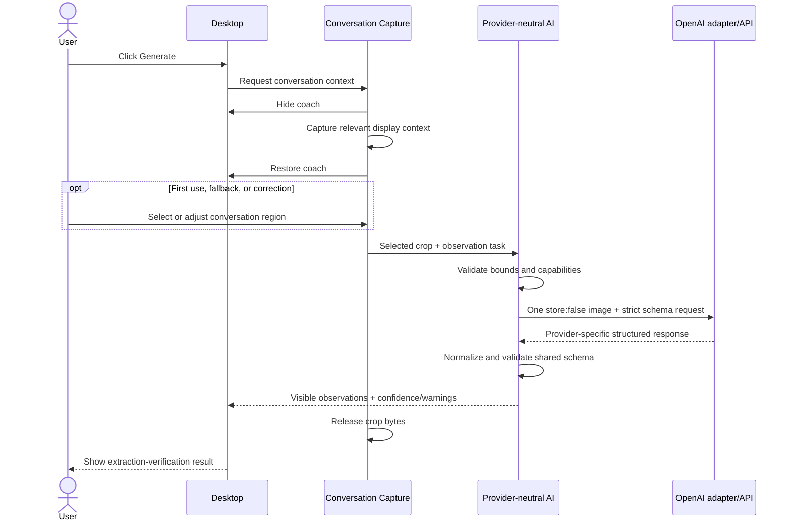
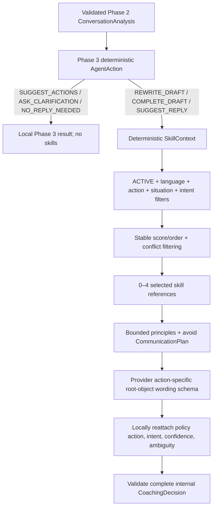

# Architecture

## Purpose and constraints

AI Message Coach must answer one MVP question: can it look at the conversation currently visible on a user's screen and help them say the right thing without first making them explain everything?

The implemented architecture optimizes for that proof, sensitive-data minimization, and clear future seams. DATA-00 specifies the local Data + Memory direction; DATA-01 adds protected persistence; DATA-02 adds internal contact/identity persistence and reversible association lifecycle APIs; MEM-00 adds a typed assertion/evidence foundation; and DATA-03 adds internal relationship-history specializations without production data-entry UI or automatic acquisition. Observation-driven population, summaries, profiles, and coaching retrieval remain unimplemented. Multiple services, thousands of skills, and multiple client platforms are not current optimization targets.

Key constraints:

- Windows desktop is first; iOS is a future client.
- An explicitly triggered conversation-capture capability is the universal context interface; screen capture is an internal implementation detail.
- The Generate button is the primary user-facing trigger. Shortcuts and future quick actions are optional callers of the same capability.
- Prefer one normal model call. The implemented staged path currently uses one extraction call followed by a wording call when needed; this is a documented gap from the preferred budget, not permission to add calls silently. DATA-00 adds no runtime calls. Future background memory tasks need their own bounded usage policy and never add a foreground extraction call.
- Users bring credentials for a supported provider and pay that provider directly; provider costs are not bundled with Message Coach.
- Core coaching logic is provider-neutral. Model eligibility is determined by capabilities, not provider names.
- Direct encrypted communication from the trusted desktop process to the selected provider is preferred when practical so private conversations do not unnecessarily cross application-operated infrastructure.
- Raw screenshots are ephemeral by default.
- Model output is untrusted until it passes a shared runtime schema.
- The user remains in control; the system never sends a message.

## Logical engines, not microservices

The long-term system has five logical engines:

1. **Context Engine** — extracts visible conversation observations. Phase 2 stops at messages/order/ownership, draft, visible contact signals, language, warnings, and extraction confidence; later inference work requires its own approved scope.
2. **Memory Engine** — retrieves relevant trusted history, assesses freshness, and proposes evidence-backed memory candidates.
3. **Skill Engine** — Phase 4 deterministically filters, ranks, and composes a small approved communication-skill registry; large-catalog retrieval/reranking remains future work.
4. **Response Engine** — chooses an agent action, creates a communication plan, and produces replies or action choices.
5. **Skill Factory** — an offline, governed workflow for proposing and evaluating skills.

For the MVP these are modules, not separate deployments and not separate autonomous agents. The desktop client and a selected model provider form the potential coaching path. The Fastify service remains available for HTTP functionality but is not required to proxy every provider request.

## Runtime boundaries

### Desktop application

`apps/desktop` contains three security boundaries:

- **Electron main process:** the reusable conversation-capture capability, window hide/show behavior, screen-capture permission and acquisition, trusted Phase 2/3 provider request execution, coaching orchestration, optional future shortcut registration, explicit clipboard writes, and future OS-protected credential access.
- **Preload bridge:** narrow, typed capture, provider-status, analysis, coaching, and clipboard methods. Context isolation stays enabled; the renderer gets no general Node.js access, channel selection, provider request shape, or credential value.
- **React renderer:** the primary Generate control, crop setup/correction, progress/error/retry states, safe provider/model status, extraction-verification details, action/clarification/no-reply flows, generated results, and explicit Copy.

The desktop determines and crops the relevant region locally and sends only that crop beyond the device. Phase 1 passes the full capture through the trusted main → sandboxed preload/renderer IPC path solely so the user can select it locally. Phase 2 sends the selected crop through one fixed preload method to trusted main and directly over TLS to OpenAI; it does not route the image through `apps/api`. The desktop owns ephemeral image memory and releases it after success, cancellation, recapture, reload, or unmount, retaining a crop only for an explicit retry in the active UI session. Product prompts and provider-neutral orchestration remain in `packages/ai`; Electron main is only the trusted composition root.

### Conversation-capture capability

Capture must be modeled as one reusable application capability, conceptually similar to:

```ts
requestConversationCapture();
```

The exact contract should be defined only when a capture milestone has concrete producers and consumers. Its architectural role is already fixed:

```text
Generate button ─┐
Global shortcut ─┼─→ Conversation capture workflow
Future quick UI ─┘
```

The workflow owns hide-before-capture, permission handling, capture acquisition, local region selection, restoration of the coach window, cancellation, and buffer disposal. UI triggers request the workflow; they do not implement their own capture logic. Generate is the primary product flow, while the shortcut is an optional convenience.

Capture should evolve incrementally:

1. Generate hides the coach, captures the relevant display, restores the coach, and lets the user select a conversation region.
2. A later version may remember a user-confirmed region and apply it on subsequent Generate actions, with controls to change or reset it.
3. Later evidence may justify active-window awareness, window/display bounds, or visual conversation-region detection.
4. The common-case target is Generate → automatic context capture → understanding → response, with manual crop retained as setup, fallback, and correction.

Persisting bounded region metadata such as `x`, `y`, `width`, and `height` may be acceptable in a separately approved milestone. It is not permission to retain screenshot pixels, conversation text, drafts, or inferred identity, and it must not be implemented before there is a validated caller and reset policy.

### Implemented Phase 1 capture lifecycle

The Phase 1 implementation keeps capture behind `requestConversationCapture()` in Electron main. Generate invokes one fixed preload method; the renderer cannot choose an IPC channel or pass native arguments. Main validates the owned `BrowserWindow` and its main frame, rejects overlapping requests, records the display containing the coach window, hides every visible coach window, waits one encapsulated 100 ms compositor-settle interval, captures that screen source, and restores/focuses the prior UI in `finally` on both success and failure.

The capture target baseline is one display, selected from the coach window bounds before hiding. Its DIP size and Electron `scaleFactor` request a native-sized thumbnail. `DesktopCapturerSource.display_id` must match `Display.id`; the only fallback is an unambiguous single source. The actual returned `NativeImage` dimensions are authoritative because Electron does not guarantee the requested thumbnail size. Ambiguous multi-display mapping fails safely instead of guessing.

Main converts the `NativeImage` to PNG bytes in memory. Strict Zod schemas validate the result in main and again in preload. The renderer copies the bytes into a `Blob`, zeroes that temporary copy, and uses a revocable `blob:` URL. Pointer coordinates are measured against the screenshot's actual rendered content box, normalized in every drag direction, clamped to its bounds, and converted by the intrinsic-pixel/rendered-CSS ratio. The ratio already incorporates display scaling; `window.devicePixelRatio` is deliberately not multiplied again. Near crop edges are floored, far edges are ceiled, and selections below eight CSS pixels on either dimension remain in selection mode.

Canvas produces the crop locally. Completing a crop releases the full-capture URL. In Phase 2, Continue reuses that exact crop for analysis rather than capturing again. Success, Retake, Cancel, Escape, reload, and unmount release remaining URLs/references; a normalized provider failure retains only the crop preview for explicit retry. No capture file, screenshot history, application-API request, or persisted region exists.

### API service

`apps/api` is the Fastify composition root. It owns:

- transport limits and request validation for routes that have a justified server-side role;
- request-scoped server orchestration where required;
- health and future non-provider application services;
- optional invocation of AI, skill, and memory interfaces only when an approved topology calls for server mediation;
- response serialization;
- privacy-safe metrics, request identifiers, and errors.

The API does not automatically own BYOK credentials or proxy screenshots to providers. A server-mediated model path requires an explicit technical need and privacy review covering credential flow, content retention, logging, authentication, and deployment boundaries. Route handlers should be thin. They must not embed prompts, duplicate contract types, or log sensitive payloads.

### Shared contracts

`packages/contracts` owns versioned, provider-neutral Zod schemas for IPC, HTTP, AI tasks and structured output, skills, future model metadata, normalized provider errors, and future memory records. TypeScript types are inferred from schemas so runtime and compile-time contracts cannot drift.

Phase 0 establishes:

- immutable desktop app metadata and the `/health` response;
- the `AgentAction` vocabulary and independent confidence dimensions;
- a shallow observed conversation and draft shape;
- a shallow coach result envelope without generation payloads or policy;
- error codes safe to show to users;
- the reviewed skill-definition metadata shape.

Phase 1 adds strict capture bounds/display metadata, in-memory PNG bytes, safe capture errors, a discriminated capture result, and the one allowlisted IPC channel. It does not add AI task or provider contracts.

Phase 2 adds the bounded PNG analysis request, safe provider/model/capability metadata, observation-only conversation analysis, normalized provider errors/results, and fixed provider-status/analysis IPC channels. Strict schemas reject relationship, situation, intent, skill, action, and reply fields.

Phase 3 adds strict coaching request/selection/result, action-specific payload, coaching error, clipboard, and IPC contracts. Its internal `CoachingDecision` remains a discriminated union, while provider-facing generation uses action-specific strict root-object schemas containing wording only. Phase 4 adds strict atomic skill definitions, a bounded normalized `SkillContext`, selected skill references/reasons, and a `CommunicationPlan` whose status distinguishes `SELECTED`, legitimate `NONE`, and request-scoped `FAILED`. The plan contains at most four selected references and bounded principles/avoidances. Future memory records remain absent until an approved milestone has a producer and consumer.

Do not expose chain-of-thought. Evidence should be concise, observable references such as “draft contains an apology” or message indices, not hidden reasoning transcripts.

### AI logic

`packages/ai` owns provider-neutral conversation analysis and coaching orchestration. Its current responsibilities are:

- provider-neutral task interfaces and model capability descriptors;
- an observation-only multimodal prompt;
- one bounded, strict structured extraction call;
- validation and safe failure for invalid/refused/incomplete model output;
- normalized provider failure handling;
- deterministic Phase 3 draft-aware action policy;
- deterministic Phase 4 skill-context derivation after the action is fixed;
- provider-neutral wording generation with compact composed skill guidance;
- isolated OpenAI vision and coaching adapters.

Phase 2 remains observation-only. Phase 3 chooses the action; Phase 4 chooses communication expertise for actions that need wording. The skill engine never changes the action, and relationship/identity/memory remain absent.

Core Context, Memory, Skill, and Response logic must not import provider SDKs or branch on provider name for product behavior. The Phase 2 task-specific port is `ConversationImageAnalyzer`; `OpenAiVisionAdapter` alone translates the request, authenticates, calls the Responses API with native `fetch`, extracts output, and validates it against shared schemas. No general unused provider interface or SDK was added.

Each model eventually advertises capabilities such as text generation, vision, structured output, streaming, tool calling, and embeddings. Task code declares requirements. Screenshot understanding, for example, requires vision and text generation; an incompatible model should produce a normalized unsupported-capability result before any request is sent. A provider's name is never a substitute for capability checking.

The initial experience may use one selected provider/model for every task it supports. Later evidence may justify separate vision, text, embedding, or evaluation models. Do not build complex multi-model configuration preemptively.

Business policy should be testable without a live model. For example, choosing action choices over clarification can be a deterministic decision over validated analysis rather than prompt prose alone. See `docs/llm-providers.md` for BYOK, adapter, capability, error, and topology requirements.

### BYOK credential and settings boundary

Users supply credentials for their selected provider and pay that provider's usage charges directly. Phase 2 exposes only safe provider/model/configured/capability status and a billing notice. Full settings should later add selection, connection testing, replacement, and deletion.

New credentials may pass from a settings form through a narrow validated preload write operation to Electron main, then into OS-protected credential storage where practical. Stored keys must never be readable by the React renderer. Renderer-visible state is limited to safe metadata such as provider/model identifiers, capabilities, and `configured: true | false`.

Credentials must not be committed, hard-coded, logged, included in analytics/crash reports, or attached to provider-neutral error details. Current development loads an ignored `.env.local` key into Electron main only; this is not production credential storage. OS-protected storage, deletion, replacement, and connection testing remain a separately approved production milestone.

### Skill library

Phase 4 makes `packages/skills` a first-class runtime package. It owns 21 manually approved, source-controlled atomic definitions; registry/referential validation; deterministic active/language/action/situation/intent eligibility; stable bounded ranking; bidirectional conflict checks; compact composition; and selection metrics. `packages/contracts` remains the Zod-first schema owner, while `packages/ai` derives the request-scoped context and consumes the resulting provider-neutral plan.

The engine selects zero to four skills. English can use universal + `en`; Chinese can use universal + `zh`; mixed English/Chinese may use both supported families; other languages use universal only. `SUGGEST_ACTIONS`, `ASK_CLARIFICATION`, and `NO_REPLY_NEEDED` return no skill plan. A user action selection re-enters Phase 3 first, then skills may guide the resulting reply.

Only selected `principles` and `avoid` guidance crosses into the provider request. Full definitions, selection reasons, and skill IDs stay out of the prompt. Registry validation defects fail explicitly; a request-scoped selection failure is marked `FAILED` and can fall back to generic Phase 3 generation. No provider SDK or OpenAI-specific content appears in the skill package. See `docs/skills.md`.

## Implemented monorepo

```text
apps/
├── desktop/
│   └── src/
│       ├── main/             # Electron lifecycle and secure BrowserWindow
│       │   ├── conversation-capture.ts # reusable capture service
│       │   └── capture-lifecycle.ts    # hide/capture/restore single flight
│       ├── preload/          # metadata + one typed capture command
│       └── renderer/         # Generate, local crop, preview, ready/error UI
└── api/
    └── src/
        ├── app.ts            # testable Fastify construction and health route
        └── server.ts         # loopback listening and lifecycle
packages/
├── contracts/src/            # Zod schemas + inferred types
├── ai/src/                   # provider-neutral analysis, action policy, skill context, generation
├── skills/src/               # approved registry, deterministic selection/composition/evaluation
└── test-fixtures/src/        # synthetic cross-package fixtures
```

Tests that concern one package stay next to that package. Root `tests/` is reserved for future cross-boundary and end-to-end tests with concrete callers.

The implemented Phase 4 dependency direction is:

```text
apps/desktop → packages/ai → packages/skills → packages/contracts
packages/ai → packages/contracts
apps/desktop → packages/contracts
apps/api     → packages/contracts
packages/skills → packages/contracts
packages/test-fixtures → packages/contracts
```

Trusted Electron main composes the AI task for the approved direct-provider topology. The React renderer imports only shared types and must not import provider adapters, SDKs, prompts, Fastify, or the skill registry. The credential is injected into the adapter; `packages/ai` imports neither Electron nor Fastify. `packages/ai` calls the narrow `CommunicationSkillPlanner` boundary backed by `packages/skills`; it does not absorb registry ownership. Future memory must enter through a similarly narrow approved interface, not an application composition root or storage adapter.

## Phase 0 toolchain and build

- Node.js 24 LTS and pnpm 11 are declared and the exact package manager is pinned.
- Shared packages and the API compile as ESM. Electron main and preload are bundled as CommonJS with Electron and Node built-ins externalized; the renderer is an ESM Vite build.
- The renderer build uses a relative asset base so the production `file://` entrypoint loads its bundled JavaScript and CSS.
- The Electron window enables `contextIsolation` and sandboxing, disables renderer Node integration, denies new windows and navigation, and loads no remote content in production.
- ESLint, Prettier, strict TypeScript, and Vitest are root-owned tools with canonical commands.
- Package builds clean their own `dist` directories and exclude test modules from production artifacts.
- pnpm permits install scripts only for the explicitly allowlisted Electron and esbuild dependencies and applies a 24-hour package-release maturity gate.

## Phase 2 request flow



An optional shortcut follows the same sequence by requesting the same capture capability; it is not the primary flow and does not own a separate pipeline.

Phase 2 selects the direct path: renderer → authorized preload/main IPC → provider-neutral task → isolated OpenAI adapter. `apps/api` receives neither crop nor credential. A future server path must justify the additional trust boundary; the desktop path preserves adapter isolation, trusted key access, request bounds, output validation, and safe errors.

The Phase 2 path makes one understanding call and no repair, coaching, skill, or response call. Invalid, refused, or incomplete output becomes a recoverable error. Phase 3 consumes the validated observation contract without re-extracting the screenshot. A deterministic draft-aware policy fixes one `AgentAction`; local choice, clarification, and no-reply decisions need no wording call. For rewrite/complete/reply actions, Phase 4 derives a bounded skill context from already visible evidence, deterministically selects zero to four skills, and supplies only the composed principles/avoidances to the provider-neutral text-generation call through an isolated OpenAI adapter. The adapter asks for an action-specific root-object wording payload, reattaches the policy-owned action, intent, confidence, and ambiguity locally, then validates the complete internal decision. A user choice can require one follow-up wording call using the same in-memory context after its explicit intent is selected; a retry after failure preserves and reuses that exact selection instead of returning to pre-choice policy.

Phase 3 adds fixed authorized coaching and clipboard IPC methods. The sandboxed renderer sends strict `ConversationAnalysis` plus at most one bounded selection; Electron main retains credentials, prevents overlapping coaching calls, validates every provider result, and writes clipboard text only after an explicit user action. No screenshot, conversation, generated message, or key enters `apps/api`, logs, or persistent storage.

## Phase 4 skill-guided coaching flow



`SkillContext` uses the fixed action, visible messages/draft, selected intent, normalized situation/intent tags, language/code-switching, and material ambiguity. It contains no relationship, identity, avatar, contact history, temporal history, or memory input. Selection and composition are deterministic and in-memory; selected skills are not written as user history. Development inspection may expose only structured IDs, versions, and concise reasons, never hidden reasoning or conversation content.

## Core domain shape

The action vocabulary below is implemented. The broader confidence shape illustrates later domains and does not authorize relationship, identity, or memory work in Phase 4.

```ts
type AgentAction =
  | "REWRITE_DRAFT"
  | "COMPLETE_DRAFT"
  | "SUGGEST_REPLY"
  | "SUGGEST_ACTIONS"
  | "ASK_CLARIFICATION"
  | "NO_REPLY_NEEDED";

type ConfidenceDimension =
  | "identity"
  | "relationship"
  | "situation"
  | "userIntent"
  | "otherIntent"
  | "language"
  | "skillSelection";

interface Hypothesis<T> {
  value: T;
  confidence: number; // 0..1, calibrated per dimension
  evidence: string[]; // concise references to visible observations
}
```

The system keeps these layers separate:

1. **Extracted observations (Phase 2):** visible text, message grouping/order, draft, names, UI cues, language, speaker assignment, warnings, and extraction confidence.
2. **Inferred/normalized for current approved behavior:** Phase 3 user intent/action uncertainty plus Phase 4 deterministic situation/intent tags derived from current visible evidence. Identity, memory, and any relationship hypothesis remain later approved work.
3. **Decided:** explicit Phase 3 action, then selected skill references/communication plan where wording is needed, followed by reply choices or clarification.

That separation prevents an inference such as “likely manager” from being stored or presented as an observed fact.

## Confidence policy

There is no single overall confidence that replaces dimension scores. A high-confidence professional category can safely affect tone even when the exact role (“manager”) is uncertain. A low identity score does not prevent using high-confidence situation and language evidence.

Thresholds are policy configuration to calibrate with evaluations, not universal facts. Initial implementation should:

- require very high identity confidence before retrieving contact-specific memory;
- use broad relationship categories when they are materially more certain than specific roles;
- prefer current captured-context evidence over conflicting historical data;
- generate when the intended communication outcome is clear;
- present two to four bounded actions when the situation is clear but the user's goal is not;
- ask one question only when confidence is low and plausible interpretations lead to materially different or harmful responses.

See `docs/product-behavior.md` for the decision policy.

## Failure and fallback behavior

- **Capture denied or unavailable:** explain how to grant permission or retry; do not silently capture a different source.
- **No usable conversation region:** let the user recrop; do not submit the full screen automatically.
- **Ambiguous display/source mapping:** stop with a recoverable error; do not capture a guessed monitor.
- **Network/provider failure:** retain the crop only long enough for an explicit retry in the current UI session, then release it.
- **Invalid credentials, insufficient provider credits, rate limits, unavailable models, timeouts, or unsupported capabilities:** map the provider-specific failure to a safe internal error with a useful provider-neutral user message.
- **Model lacks vision:** stop before transmission and explain that the selected model cannot analyze screenshots.
- **Invalid structured model output:** Phase 2 returns a retryable error without a repair call; never pass malformed data to the UI.
- **No applicable communication skill:** use generic Phase 3 generation with a `NONE` plan; do not force irrelevant guidance.
- **Request-scoped skill selection failure:** preserve the Phase 3 action, mark the plan `FAILED`, and use generic Phase 3 generation; registry validation defects remain explicit startup/test failures.
- **Unsupported/uncertain language:** use universal skills and preserve the visible language when possible.
- **Ambiguous speaker ownership:** avoid claims tied to identity and choose actions or one clarification if the difference is material.
- **Unsafe or impossible request:** return a safe alternative without leaking provider internals.

## Data + Memory boundaries (DATA-00)

Status: completed DATA-00 architecture contract, DATA-01 protected-preference foundation, DATA-02 internal contact directory, MEM-00 assertion/evidence foundation, and DATA-03 internal relationship history. The [memory contract](memory.md) owns domain and lifecycle semantics; the [roadmap](roadmap.md#data--memory-roadmap) assigns later bounded milestones. Outstanding live-quality and Windows capture checks remain separate.

One installed app has one LocalUserContext and one local SQLite store. There is no Message Coach account, cloud service, multi-profile authentication, or synchronization. A random local context ID is internal ownership metadata, not login identity. Durable records and references stay within that store/context.

### Module and trust ownership

| Boundary | Responsibility |
|---|---|
| apps/desktop trusted main | Composition root, active local context, main-owned observation provenance, narrow memory-control IPC, storage/key lifecycle, scheduling and cancellation |
| Trusted desktop persistence adapter | One implemented utility process with SQLCipher access, schema-v6 migrations, foreign keys, transactions, settings/directory/memory revisions, bounded keyset pages/history, atomic association/assertion/relationship transitions, and dependency-aware deletion; no domain prompts |
| React/preload | Validated edit/delete/settings operations and safe status, plus a development-only fixed read-only inspector; never keys, database handles, arbitrary queries, or authoritative observed facts supplied by renderer |
| packages/contracts | Zod-first preference, contact-directory, typed assertion/evidence/decision, inspector, renderer, and private worker protocols; later schemas are added only with their producers/consumers |
| packages/ai | Provider-neutral memory task ports, model-facing prompts, validated proposals and reasoning/retrieval policy; no SQLite/Electron/Fastify/provider SDK dependency in core |
| packages/skills | Approved task-specific memory skill definitions, validation, selection/composition alongside existing governance; no second registry or new coaching action enum |
| apps/api | No role in the local memory path; not a proxy or credential owner |

Do not create new packages/services until an approved caller needs them. The eventual memory port follows the existing narrow skill-planner pattern. The desktop composes it; reasoning cannot import the storage adapter. Any CPU-heavy or synchronous database work must use a trusted execution mechanism that preserves UI responsiveness; merely returning a promise is insufficient. Worker/thread choice is an implementation detail, not a new service boundary.

### Foreground and background contract

Validated main-owned ConversationAnalysis feeds foreground coaching and a bounded non-waiting MemoryObservation handoff. Foreground may read a bounded already committed snapshot under a deadline; it never awaits current acquisition/extraction/storage and falls back to current context when memory is unavailable. Late background completion does not replace a shown reply.

The background path reads only relevant compact state, computes a validated proposal, and commits effects plus a replay receipt atomically after checking revisions and deletion generations. It has finite queue, byte, token, call, retry, and time budgets. Raw-text-bearing queue entries are ephemeral; best-effort loss before commit is acceptable. No provider request runs inside a database write transaction. No full-history prompt, autonomous retrieval loop, raw disk spool, or background continuous capture is permitted.

The existing extraction schema lacks stable message/account IDs, timestamps, and per-message participant attribution. Unknowns remain unknown until separately approved observation extensions. The existing wording prompt and factual-anchor guards must change together at MEM-05; memory cannot weaken explicit action, intent, refusal, uncertainty, or commitment safeguards.

### Storage decision and implementation gate

Select encrypted SQLite for real local structured memory, with SQLCipher the preferred engine and a random database key protected by the OS through trusted desktop code. Normal SQLite with filesystem permissions alone does not satisfy the durable-memory privacy requirement. A local store fits SQLite's device-local, low-writer-concurrency purpose; no PostgreSQL or network filesystem database is planned. See [SQLite deployment guidance](https://www.sqlite.org/whentouse.html).

DATA-01 selected the free SQLCipher Community 4.17.0 engine with OpenSSL 3.6.4 and the BSD-3-Clause `@appthreat/sqlite3` 9.0.2 wrapper. The reviewed Windows x64 Node-API 10 artifact passed Electron 43.3.0 main/utility-process and relocated-layout checks, correct/wrong/no-key behavior, cipher integrity, encrypted database and rollback-journal inspection, and compile/runtime memory-only temporary storage. The build stages only the reviewed hash and verifies `cipher_version`, provider, and compile options again before schema access. SQLCipher is an encryption-enabled SQLite build, not a capability assumed of every SQLite binding; failure of any check leaves local memory unavailable, never plaintext. See the [artifact provenance](../apps/desktop/native/README.md) and [SQLCipher design](https://www.zetetic.net/sqlcipher/design/).

The Local Memory Inspector is a development diagnostic, not a second adapter or production feature. Main requires an unpackaged app at the exact allowlisted desktop development URL; preload independently requires Electron's default development-app mode and that same marker, and the renderer renders by capability. Packaged and production-bundle sessions therefore have no inspector handler or bridge method. Its strict section/page request is serialized by the normal coordinator and executed by the existing utility process as fixed read-only statements. The validated response includes availability, schema version, the development database path, local context IDs/revisions, the explicit-preference projection, and one bounded page of contacts, identities, associations, assertions, evidence, links, decisions, or relationship contexts. Assertion/evidence pages may be filtered to relationship predicates with revision- and filter-bound cursors. It includes no key material, SQL, mutation, or plaintext copy. Summary, profile, and receipt sections remain absent. Production also has no contact-directory or generic-assertion IPC/preload method; both lifecycles are trusted-main/utility internals only.

For deeper development inspection, `pnpm --filter @ai-message-coach/desktop debug:memory-snapshot` launches the normal unpackaged Electron entry in a dedicated no-window mode. It obtains the live key only through the existing main key-custody and coordinator path, then asks the same utility process to `ATTACH` a new database with an independently generated passphrase and copy data with SQLCipher's `sqlcipher_export()`. The resulting OS-temporary SQLCipher-v4 snapshot is marked read-only and is the only file given to SQLiteStudio/Letos; the live database path, wrapped key, and raw application key are never returned to the external tool. Pressing Enter removes the generated temporary directory. Packaged builds cannot enter this mode because it requires Electron's development-app marker.

`pnpm --filter @ai-message-coach/desktop debug:memory-gui` is the Windows Letos wrapper around the same export. Main detects the installed Letos executable, requires its SQLite3MultipleCiphers plugin, and creates a disposable portable Letos configuration beside the snapshot. That temporary configuration registers only the snapshot with the `sqlcipher` cipher, compatibility/legacy 4, and `query_only`; it contains the independently generated snapshot password but never the application key. Letos is launched without a database path or password in its process arguments, the normal Letos profile is not read or changed, and both the portable profile and snapshot are removed after Letos exits. No renderer, IPC, storage-worker, production encryption, or live-store path changes are involved.

Main owns OS-protected key custody; the renderer receives status only. Provider API keys are separate from the database and ordinary memory records. OS-user protection is the MVP threat boundary; no independently unlocked application vault or recovery account. Losing access to the OS-protected key can lose access to local memory until a separately approved recovery/export mechanism exists. Windows OS protection does not protect against all other applications running as the same OS user; see [Electron safeStorage](https://www.electronjs.org/docs/latest/api/safe-storage).

Schema v2 binds the OS-wrapped envelope's random store ID to the encrypted singleton context. Versions 1–3 migrate transactionally through v4; v4-to-v5 rebuilds the constrained assertion/evidence/link/decision tables, verifies foreign keys before commit, and adds contact-owned immutable relationship-context and relationship assertion/evidence/decision subtype tables. V5-to-v6 adds a constrained transition-decision/evidence dependency for temporal ends. It attributes an old v5 end only if the latest transition has exactly one timestamp-matched linked source; otherwise it invalidates the unsupported end and historical applicability rather than laundering uncertainty into a fact. The old explicit-preference table becomes one confirmed assertion with migration-labelled evidence and is removed, while settings/directory state, IDs, references, and timestamps are preserved. A newer schema, corrupt database, missing/wrong key, or mismatched store ID is preserved and reported unavailable. A timed-out dispatched mutation retires its utility process and blocks later mutation until a status refresh has reopened the database and returned authoritative state. Inaccessible-storage recovery is a separate explicit confirmation: after the worker exits, it writes a reset marker, deletes only enumerated database/sidecar/envelope files, removes the marker last, and creates a new empty encrypted store. A crash leaves the marker and the store unavailable until the same bounded reset resumes. Normal clear-all remains an in-database generation-changing transaction and does not rotate the key. Application schema v6 does not change SQLCipher compatibility version 4.

DATA-03 stores relationship values only as typed child fields of canonical assertion/evidence rows. The child rows cannot exist without their parent; evidence links and decisions still reference those same canonical IDs. The worker atomically creates a context with its first proposal or requires explicit reuse, checks contact revision, per-scope version/episode limits, predicate-aware positive/negative support, and exact correction reach before changes. Separate role/category claims and episode IDs permit coexistence; one active accepted version of the same proposition/episode is checked under the single serialized writer. Factual correction rejects a false claim rather than superseding it as true history; an explicit transition preserves acceptance and source-linked end uncertainty through its own evidence dependency. Removing temporal evidence recomputes the surviving end or makes it unknown without discarding independently supported role acceptance. Unsupported positive role truth is downgraded to a rejected/unknown anchor if necessary to preserve its scoped correction. Partial-time overlap remains unresolved unless provably disjoint. Relationship acquisition remains synthetic-only until a later observation/review milestone authorizes real provenance.

The bounded internal as-of read evaluates applicable rejection/factual-correction scopes before returning a relationship's effective applicability. Current-reach corrections apply from the decision time forward, while an earlier provable validity interval remains queryable; interval/all-history corrections are conservative at overlap. The v5→v6 migration reclassifies only a uniquely attributable old transition link from generic `SUPPORTS` to `CONTEXTUALIZES`, then invokes the existing unsupported-evidence cleanup in the same encrypted transaction. A formerly confirmed role with no independent positive support is not retained as trusted history. This does not create a second relationship reader or change renderer access.

Native loading supports development/relocated layouts and rewrites an `app.asar` native path to `app.asar.unpacked`; a future distributor must configure `dist/native/**` for unpacking. Installer creation, signing, and update delivery remain release responsibilities outside DATA-01.

Useful structured knowledge and history may remain indefinitely. Freshness/relevance/applicability filter retrieval rather than delete records for age. UI corrections override inference; deleting sources removes dependent summary/profile influence and invalidates in-flight work. See [privacy controls](privacy.md#local-memory-storage-data-00).

## Deferred architecture

The following have intentional seams but no MVP implementation:

- cloud storage, PostgreSQL-backed repositories, accounts, multi-profile, and synchronization (not part of the local Data + Memory roadmap);
- semantic/hybrid retrieval, reranking, and pgvector for a large skill catalog;
- local avatar/identity matching;
- automatic acquisition, interaction summaries, profiles, and coaching retrieval beyond the implemented encrypted contact/assertion/relationship store;
- offline Skill Factory services and review tooling;
- iOS, Share Extension, and custom keyboard clients;
- application-specific messaging integrations;
- remembered capture-region metadata, active-window awareness, and automatic conversation-region detection until separately approved;
- production BYOK settings, secure credential storage, additional provider adapters, multi-provider routing, and custom/local endpoints until separately approved;
- insertion automation and automatic sending (automatic sending remains prohibited).

Adding a seam means defining a small interface at the point of use—not building unused adapters, services, or deployment infrastructure.
