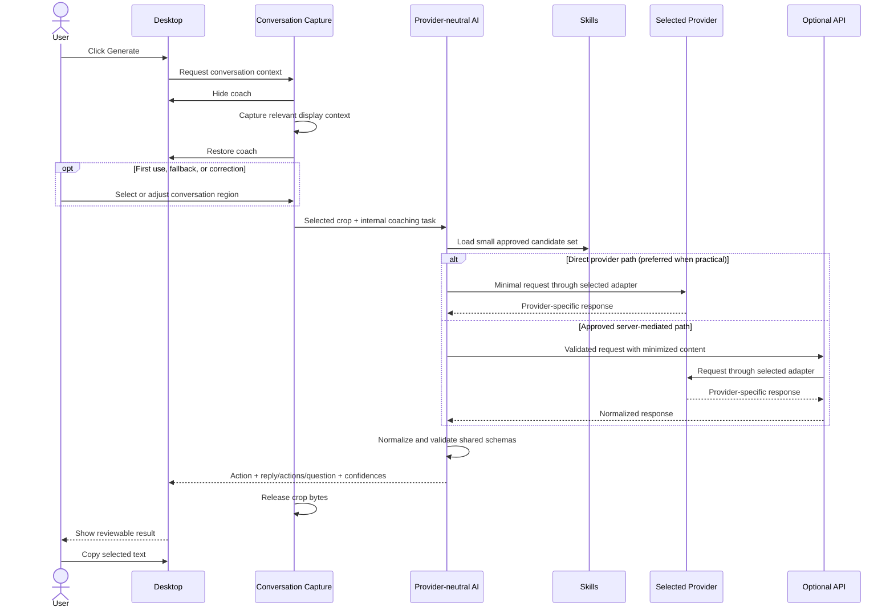

# Architecture

## Purpose and constraints

AI Message Coach must answer one MVP question: can it look at the conversation currently visible on a user's screen and help them say the right thing without first making them explain everything?

The architecture optimizes for that proof, sensitive-data minimization, and clear future seams. It does not optimize yet for many services, thousands of skills, durable personal memory, or multiple client platforms.

Key constraints:

- Windows desktop is first; iOS is a future client.
- An explicitly triggered conversation-capture capability is the universal context interface; screen capture is an internal implementation detail.
- The Generate button is the primary user-facing trigger. Shortcuts and future quick actions are optional callers of the same capability.
- The MVP uses a small number of model calls: normally one, at most a second after necessary clarification.
- Users bring credentials for a supported provider and pay that provider directly; provider costs are not bundled with Message Coach.
- Core coaching logic is provider-neutral. Model eligibility is determined by capabilities, not provider names.
- Direct encrypted communication from the trusted desktop process to the selected provider is preferred when practical so private conversations do not unnecessarily cross application-operated infrastructure.
- Raw screenshots are ephemeral by default.
- Model output is untrusted until it passes a shared runtime schema.
- The user remains in control; the system never sends a message.

## Logical engines, not microservices

The long-term system has five logical engines:

1. **Context Engine** — extracts the visible conversation and draft, then estimates identity, relationship, situation, intents, and language.
2. **Memory Engine** — retrieves relevant trusted history, assesses freshness, and proposes evidence-backed memory candidates.
3. **Skill Engine** — filters, retrieves, reranks, and composes approved communication skills.
4. **Response Engine** — chooses an agent action, creates a communication plan, and produces replies or action choices.
5. **Skill Factory** — an offline, governed workflow for proposing and evaluating skills.

For the MVP these are modules, not separate deployments and not separate autonomous agents. The desktop client and a selected model provider form the potential coaching path. The Fastify service remains available for HTTP functionality but is not required to proxy every provider request.

## Runtime boundaries

### Desktop application

`apps/desktop` will contain three security boundaries:

- **Electron main process:** the reusable conversation-capture capability, window hide/show behavior, screen-capture permission and acquisition, optional global-shortcut registration, clipboard writes, future OS-protected credential access, and—when selected—trusted direct provider request execution.
- **Preload bridge:** a narrow, typed IPC API. Context isolation stays enabled; the renderer gets no general Node.js access or stored credential values.
- **React renderer:** the primary Generate control, crop setup/correction, progress/error states, future provider/model settings using safe configuration status, result choices, clarification UI, and copy controls.

The desktop app should determine and crop the relevant region locally and send only that region beyond the desktop trust boundary. Phase 1 passes the full capture through the trusted main → sandboxed preload/renderer IPC path solely so the user can select it locally; no full capture or crop reaches a network boundary. Early implementations may require the user to select it; later implementations may reuse a previously confirmed region or infer one automatically. The desktop owns ephemeral image memory and must release it after the request completes or is cancelled. Product prompts and communication policy remain in `packages/ai`; a trusted Electron composition root may invoke a provider-neutral adapter without moving that policy into Electron-specific code.

### Conversation-capture capability

Capture must be modeled as one reusable application capability, conceptually similar to:

```ts
requestConversationCapture();
```

The exact contract should be defined only when a capture milestone has concrete producers and consumers. Its architectural role is already fixed:

```text
Generate button ─┐
Global shortcut ─┼─→ Conversation capture workflow
Future quick UI ─┘
```

The workflow owns hide-before-capture, permission handling, capture acquisition, local region selection, restoration of the coach window, cancellation, and buffer disposal. UI triggers request the workflow; they do not implement their own capture logic. Generate is the primary product flow, while the shortcut is an optional convenience.

Capture should evolve incrementally:

1. Generate hides the coach, captures the relevant display, restores the coach, and lets the user select a conversation region.
2. A later version may remember a user-confirmed region and apply it on subsequent Generate actions, with controls to change or reset it.
3. Later evidence may justify active-window awareness, window/display bounds, or visual conversation-region detection.
4. The common-case target is Generate → automatic context capture → understanding → response, with manual crop retained as setup, fallback, and correction.

Persisting bounded region metadata such as `x`, `y`, `width`, and `height` may be acceptable in a separately approved milestone. It is not permission to retain screenshot pixels, conversation text, drafts, or inferred identity, and it must not be implemented before there is a validated caller and reset policy.

### Implemented Phase 1 capture lifecycle

The Phase 1 implementation keeps capture behind `requestConversationCapture()` in Electron main. Generate invokes one fixed preload method; the renderer cannot choose an IPC channel or pass native arguments. Main validates the owned `BrowserWindow` and its main frame, rejects overlapping requests, records the display containing the coach window, hides every visible coach window, waits one encapsulated 100 ms compositor-settle interval, captures that screen source, and restores/focuses the prior UI in `finally` on both success and failure.

The capture target baseline is one display, selected from the coach window bounds before hiding. Its DIP size and Electron `scaleFactor` request a native-sized thumbnail. `DesktopCapturerSource.display_id` must match `Display.id`; the only fallback is an unambiguous single source. The actual returned `NativeImage` dimensions are authoritative because Electron does not guarantee the requested thumbnail size. Ambiguous multi-display mapping fails safely instead of guessing.

Main converts the `NativeImage` to PNG bytes in memory. Strict Zod schemas validate the result in main and again in preload. The renderer copies the bytes into a `Blob`, zeroes that temporary copy, and uses a revocable `blob:` URL. Pointer coordinates are measured against the screenshot's actual rendered content box, normalized in every drag direction, clamped to its bounds, and converted by the intrinsic-pixel/rendered-CSS ratio. The ratio already incorporates display scaling; `window.devicePixelRatio` is deliberately not multiplied again. Near crop edges are floored, far edges are ceiled, and selections below eight CSS pixels on either dimension remain in selection mode.

Canvas produces the crop locally. Completing a crop releases the full-capture URL; Retake, Cancel, Escape, Continue, errors, reload, and unmount release every remaining URL/reference. Continue discards the preview and reaches the text-only `Capture ready for analysis.` state. No capture file, screenshot history, API request, provider call, OCR, or persisted region exists.

### API service

`apps/api` is the Fastify composition root. It owns:

- transport limits and request validation for routes that have a justified server-side role;
- request-scoped server orchestration where required;
- health and future non-provider application services;
- optional invocation of AI, skill, and memory interfaces only when an approved topology calls for server mediation;
- response serialization;
- privacy-safe metrics, request identifiers, and errors.

The API does not automatically own BYOK credentials or proxy screenshots to providers. A server-mediated model path requires an explicit technical need and privacy review covering credential flow, content retention, logging, authentication, and deployment boundaries. Route handlers should be thin. They must not embed prompts, duplicate contract types, or log sensitive payloads.

### Shared contracts

`packages/contracts` owns versioned, provider-neutral Zod schemas for IPC, HTTP, AI tasks and structured output, skills, future model metadata, normalized provider errors, and future memory records. TypeScript types are inferred from schemas so runtime and compile-time contracts cannot drift.

Phase 0 establishes:

- immutable desktop app metadata and the `/health` response;
- the `AgentAction` vocabulary and independent confidence dimensions;
- a shallow observed conversation and draft shape;
- a shallow coach result envelope without generation payloads or policy;
- error codes safe to show to users;
- the reviewed skill-definition metadata shape.

Phase 1 adds strict capture bounds/display metadata, in-memory PNG bytes, safe capture errors, a discriminated capture result, and the one allowlisted IPC channel. It does not add AI task or provider contracts.

Image inputs, model/capability metadata, provider-neutral task requests, normalized errors, evidence references, action-specific response payloads, and selection results are added only when their approved milestone has a producer and consumer.

Do not expose chain-of-thought. Evidence should be concise, observable references such as “draft contains an apology” or message indices, not hidden reasoning transcripts.

### AI logic

`packages/ai` remains an intentionally empty, buildable boundary through Phase 1. Phase 2 may add deterministic provider-independent policy and neutral interfaces at real call sites while isolating provider-specific behavior in adapters. The package will own:

- provider-neutral task interfaces and model capability descriptors;
- prompt/version definitions;
- multimodal structured extraction;
- confidence-aware action selection;
- communication planning and response generation;
- repair/fallback behavior for invalid model output;
- normalized provider failure handling;
- a future memory-reader interface, initially implemented as no memory.

Core Context, Memory, Skill, and Response logic must not import provider SDKs or branch on provider name for product behavior. Provider adapters alone translate internal tasks, authenticate, call provider APIs, convert responses, and validate them against shared schemas. The exact interface and folder layout remain deferred; a conceptual `LlmProvider` is documented in `docs/llm-providers.md`, but no unused interface or adapter should be created before a concrete caller exists.

Each model eventually advertises capabilities such as text generation, vision, structured output, streaming, tool calling, and embeddings. Task code declares requirements. Screenshot understanding, for example, requires vision and text generation; an incompatible model should produce a normalized unsupported-capability result before any request is sent. A provider's name is never a substitute for capability checking.

The initial experience may use one selected provider/model for every task it supports. Later evidence may justify separate vision, text, embedding, or evaluation models. Do not build complex multi-model configuration preemptively.

Business policy should be testable without a live model. For example, choosing action choices over clarification can be a deterministic decision over validated analysis rather than prompt prose alone. See `docs/llm-providers.md` for BYOK, adapter, capability, error, and topology requirements.

### BYOK credential and settings boundary

Users supply credentials for their selected provider and pay that provider's usage charges directly. Future settings should show provider, model, relevant capabilities, connection status, and a clear billing disclosure.

New credentials may pass from a settings form through a narrow validated preload write operation to Electron main, then into OS-protected credential storage where practical. Stored keys must never be readable by the React renderer. Renderer-visible state is limited to safe metadata such as provider/model identifiers, capabilities, and `configured: true | false`.

Credentials must not be committed, hard-coded, logged, stored in plaintext configuration, included in analytics/crash reports, or attached to provider-neutral error details. Credential storage, deletion, replacement, and connection testing are future milestone work, not Phase 0 or Phase 1 work.

### Skill library

In Phase 0, `packages/skills` only validates a definition with the contract-owned schema. It owns no catalog and ships no production skill. Later it will own structured, versioned, approved skill data plus deterministic metadata filtering and conflict/dependency resolution. Skill content and selection remain provider-independent; model-assisted reranking calls a neutral AI task boundary. Initial scale does not need embeddings or a vector database. See `docs/skills.md`.

## Implemented monorepo

```text
apps/
├── desktop/
│   └── src/
│       ├── main/             # Electron lifecycle and secure BrowserWindow
│       │   ├── conversation-capture.ts # reusable capture service
│       │   └── capture-lifecycle.ts    # hide/capture/restore single flight
│       ├── preload/          # metadata + one typed capture command
│       └── renderer/         # Generate, local crop, preview, ready/error UI
└── api/
    └── src/
        ├── app.ts            # testable Fastify construction and health route
        └── server.ts         # loopback listening and lifecycle
packages/
├── contracts/src/            # Zod schemas + inferred types
├── ai/src/                   # empty boundary until a concrete Phase 1 caller
├── skills/src/               # skill-definition validation only
└── test-fixtures/src/        # synthetic cross-package fixtures
```

Tests that concern one package stay next to that package. Root `tests/` is reserved for future cross-boundary and end-to-end tests with concrete callers.

The implemented Phase 0 dependency direction is:

```text
apps/desktop → packages/contracts
apps/api     → packages/contracts
packages/skills → packages/contracts
packages/test-fixtures → packages/contracts
packages/ai  → no dependency yet
```

Future dependencies may add `packages/ai → packages/contracts` plus a composition root in trusted Electron main or `apps/api`, depending on the approved request topology. The React renderer must not import provider adapters, SDKs, prompts, Fastify, or the skill registry. Electron-specific credential access must be injected into provider-neutral AI code rather than imported by `packages/ai`. Domain packages must not import Electron or Fastify. If `packages/ai` needs skill or memory data, prefer an injected narrow interface over importing an application composition root or future storage adapter.

## Phase 0 toolchain and build

- Node.js 24 LTS and pnpm 11 are declared and the exact package manager is pinned.
- Shared packages and the API compile as ESM. Electron main and preload are bundled as CommonJS with Electron and Node built-ins externalized; the renderer is an ESM Vite build.
- The renderer build uses a relative asset base so the production `file://` entrypoint loads its bundled JavaScript and CSS.
- The Electron window enables `contextIsolation` and sandboxing, disables renderer Node integration, denies new windows and navigation, and loads no remote content in production.
- ESLint, Prettier, strict TypeScript, and Vitest are root-owned tools with canonical commands.
- Package builds clean their own `dist` directories and exclude test modules from production artifacts.
- pnpm permits install scripts only for the explicitly allowlisted Electron and esbuild dependencies and applies a 24-hour package-release maturity gate.

## MVP request flow



An optional shortcut follows the same sequence by requesting the same capture capability; it is not the primary flow and does not own a separate pipeline.

The direct path is the privacy preference, not an irreversible implementation choice. Before real screenshots are sent, the approved provider milestone must decide and test where the provider-neutral runtime is composed. A server path must justify the additional trust boundary; a desktop path must preserve SDK isolation, secure key access, request bounds, and output validation.

The normal path combines understanding and response generation in one model request. A second request is permitted only if the first result is `ASK_CLARIFICATION` and the user's single answer materially changes the response. If reliable single-call skill selection is not possible, a deterministic local prefilter may select candidates before the model request; adding a separate selection model call is not the default.

## Core domain shape

Names are illustrative until Phase 0 defines the actual schemas.

```ts
type AgentAction =
  | "REWRITE_DRAFT"
  | "COMPLETE_DRAFT"
  | "SUGGEST_REPLY"
  | "SUGGEST_ACTIONS"
  | "ASK_CLARIFICATION"
  | "NO_REPLY_NEEDED";

type ConfidenceDimension =
  | "identity"
  | "relationship"
  | "situation"
  | "userIntent"
  | "otherIntent"
  | "language"
  | "skillSelection";

interface Hypothesis<T> {
  value: T;
  confidence: number; // 0..1, calibrated per dimension
  evidence: string[]; // concise references to visible observations
}
```

The analysis contract should keep these layers separate:

1. **Observed:** visible text, message grouping/order, draft, names, UI cues, and language tokens.
2. **Inferred:** speaker ownership, relationship, situation, intents, emotion, identity hypothesis, and confidence.
3. **Decided:** selected action, communication plan, skills, reply choices, or clarification.

That separation prevents an inference such as “likely manager” from being stored or presented as an observed fact.

## Confidence policy

There is no single overall confidence that replaces dimension scores. A high-confidence professional category can safely affect tone even when the exact role (“manager”) is uncertain. A low identity score does not prevent using high-confidence situation and language evidence.

Thresholds are policy configuration to calibrate with evaluations, not universal facts. Initial implementation should:

- require very high identity confidence before retrieving contact-specific memory;
- use broad relationship categories when they are materially more certain than specific roles;
- prefer current captured-context evidence over conflicting historical data;
- generate when the intended communication outcome is clear;
- present two to four bounded actions when the situation is clear but the user's goal is not;
- ask one question only when confidence is low and plausible interpretations lead to materially different or harmful responses.

See `docs/product-behavior.md` for the decision policy.

## Failure and fallback behavior

- **Capture denied or unavailable:** explain how to grant permission or retry; do not silently capture a different source.
- **No usable conversation region:** let the user recrop; do not submit the full screen automatically.
- **Ambiguous display/source mapping:** stop with a recoverable error; do not capture a guessed monitor.
- **Network/provider failure:** retain the crop only long enough for an explicit retry in the current UI session, then release it.
- **Invalid credentials, insufficient provider credits, rate limits, unavailable models, timeouts, or unsupported capabilities:** map the provider-specific failure to a safe internal error with a useful provider-neutral user message.
- **Model lacks vision:** stop before transmission and explain that the selected model cannot analyze screenshots.
- **Invalid structured model output:** attempt one bounded schema repair or return a retryable error; never pass malformed data to the UI.
- **Unsupported/uncertain language:** use universal skills and preserve the visible language when possible.
- **Ambiguous speaker ownership:** avoid claims tied to identity and choose actions or one clarification if the difference is material.
- **Unsafe or impossible request:** return a safe alternative without leaking provider internals.

## Deferred architecture

The following have intentional seams but no MVP implementation:

- PostgreSQL-backed memory repositories;
- pgvector/hybrid retrieval for a large skill catalog;
- local avatar/identity matching;
- durable encrypted user/contact/interaction memory;
- offline Skill Factory services and review tooling;
- iOS, Share Extension, and custom keyboard clients;
- application-specific messaging integrations;
- remembered capture-region metadata, active-window awareness, and automatic conversation-region detection until separately approved;
- BYOK settings, secure credential storage, provider adapters, multi-provider routing, and custom/local endpoints until separately approved;
- insertion automation and automatic sending (automatic sending remains prohibited).

Adding a seam means defining a small interface at the point of use—not building unused adapters, services, or deployment infrastructure.
